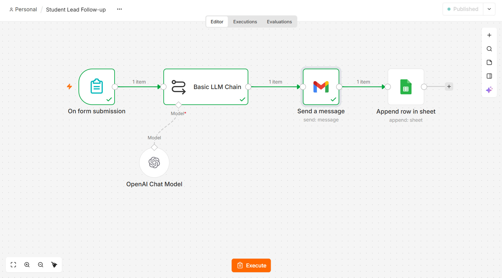
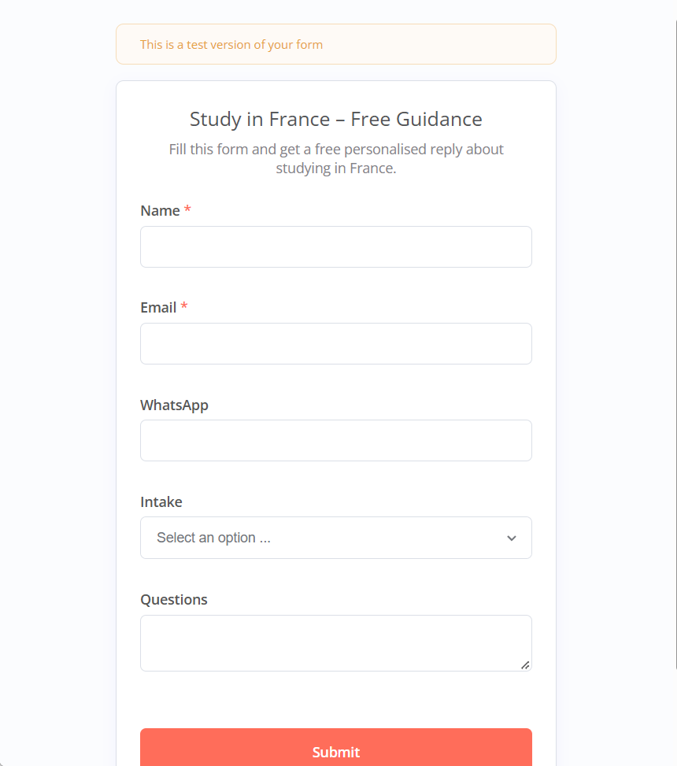
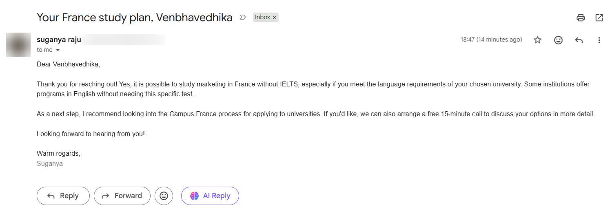
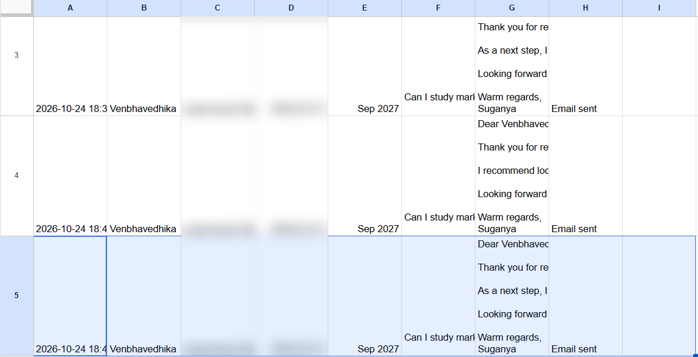

# 🤖 AI Lead Follow-up Agent (n8n + OpenAI)

An AI-powered automation that instantly replies to student enquiries with a personalised email and logs every lead in Google Sheets — **zero manual work per lead**.

Built with **n8n** (no-code workflow automation), **OpenAI GPT-4o-mini**, **Gmail** and **Google Sheets**.

---

## 🎯 Problem

I run a small study-abroad guidance service. Students send enquiries at all hours, and replying to each one manually took time — slow replies meant lost leads, and there was no single place to track who had contacted me.

## 💡 Solution

An automated agent that:

1. **Captures** the enquiry through a web form (name, email, WhatsApp, intake, question)
2. **Generates** a warm, personalised reply with AI, answering the student's actual question and suggesting next steps
3. **Sends** the reply instantly from Gmail
4. **Logs** the lead, question, AI reply and status in a Google Sheet (simple CRM)

## 🔄 Workflow

```
[ n8n Form ] ──▶ [ Basic LLM Chain + OpenAI ] ──▶ [ Gmail: Send ] ──▶ [ Google Sheets: Append row ]
  enquiry           personalised reply              email to student        lead saved in CRM
```



## 🛠️ Tools

| Tool | Role |
|---|---|
| n8n Form Trigger | Public enquiry form that starts the workflow |
| Basic LLM Chain + OpenAI Chat Model (gpt-4o-mini) | Writes the personalised reply |
| Gmail | Sends the reply to the student |
| Google Sheets | Stores every lead with date, details, AI reply and status |

## 🧠 AI Prompt (summary)

The model acts as a friendly study-abroad counsellor and writes a reply of max 150 words that greets the student by first name, answers their question briefly and honestly, suggests 1–2 next steps (e.g. Campus France process, a free 15-min call) and signs off.

## 📸 Screenshots

| Enquiry form | Email received | Lead logged in Google Sheets |
|---|---|---|
|  |  |  |

## 🎥 Demo video

▶️ [Watch the 90-second demo]https://youtu.be/xEX9X3DmN1s

## 🚀 How to use this workflow

1. Create a free account on [n8n](https://n8n.io)
2. In n8n: **⋯ menu → Import from File** → select `student-lead-followup.json`
3. Connect your own credentials (OpenAI, Gmail, Google Sheets)
4. Create a Google Sheet with the headers:
   `Date | Name | Email | WhatsApp | Intake | Questions | AI Reply | Status`
5. Select your sheet in the Google Sheets node, then **Publish** and share the form's Production URL

## 📈 Results

- Instant reply to every enquiry, 24/7
- Each reply is personalised to the student's own question
- All leads tracked automatically in one sheet

## 🔮 Next improvements

- Telegram/WhatsApp alert to me for every new lead
- Lead scoring by AI (hot / warm / cold)
- Automatic follow-up email if no response after 3 days

---

👩‍💻 **Built by Suganya** — MSc Artificial Intelligence & Marketing Strategy, EPITA Paris
🔗 [LinkedIn](https://linkedin.com/in/suganyaraju10)
